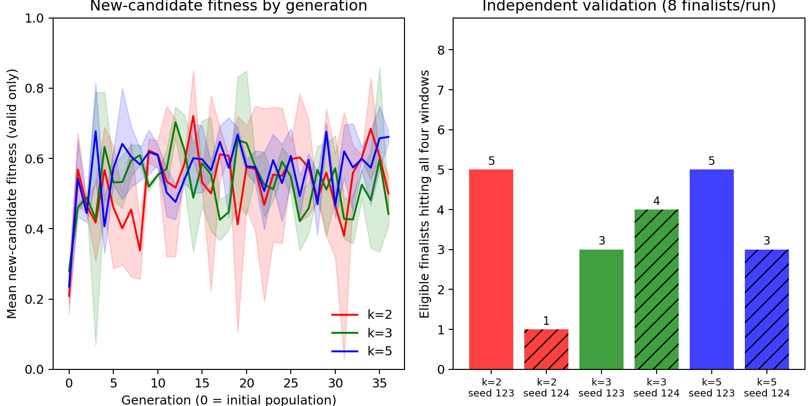

# SAGA

**Surrogate-assisted genetic search for layered alloy compositions, evaluated with MACE.**

SAGA searches discrete element counts in each slab layer and samples atomic arrangements and adsorbate placements for each genome. MACE supplies energies and forces for local relaxation. A Gaussian-process surrogate learns composition–energy relationships and helps select which new genomes merit these expensive evaluations. The objective brings several mean adsorption energies into specified windows.

This research release provides a tiny CPU example and larger GPU recipes using **one shared implementation**. The main demonstrated use case is ammonia: `nh3` uses H, N, N₂ and NH₃; `nh3_full` adds NH and NH₂. SAGA screens adsorption descriptors; NEB barriers, vibrational corrections and microkinetic rates are separate downstream calculations.

## Start with the CPU example

Python 3.10+ on Linux or macOS. Native Windows is not supported by the run-locking implementation; use WSL. Create an environment and install PyTorch for the intended CPU/CUDA platform using the [official selector](https://pytorch.org/get-started/locally/), then:

```bash
python3 -m venv .venv
source .venv/bin/activate
python -m pip install --upgrade pip
# Install the appropriate PyTorch build in this environment first.
python -m pip install -e '.[mace,plots]'
python -m saga.campaign --recipe examples/toy_cpu.json --seed 123 \
  --model models/fine-tuned.model --root runs/toy
```

Supply a compatible, trusted local MACE model containing all required elements, including H and N. **No model is bundled, downloaded automatically, or replaced by a cheaper potential.** A filename is arbitrary; model contents are checked by SHA-256. See the [model notes](docs/models.md) and [MACE installation guide](https://mace-docs.readthedocs.io/en/latest/guide/installation.html).

The CPU example uses a Cu/Ni/Pd pool, exactly two elements per slab, 12 atoms, (111), four initial genomes and two generations of three new genomes. It samples only one configuration and one probe per species during search, followed by a small fresh validation. This deliberately sparse example demonstrates execution; it cannot establish catalyst quality or uncertainty calibration. Relaxations still have a 500-step cap and 0.05 eV/Å slab/adsorbate force tolerance. CPU MACE can take appreciable time even at this size.

Check settings with `--dry-run`. Resubmit the **same command** to resume interrupted work or skip a completed run. Use a fresh output root after changing scientific settings or source.

## Presets

| Recipe | Use | Reaction | Device | Search budget |
|---|---|---|---|---|
| `examples/toy_cpu.json` | Minimal runnable MACE example | Four adsorbates | CPU, ASE relaxer | 4 initial + 2×3 new |
| `examples/nh3_gpu.json` | Modest GPU demonstration | Four adsorbates | CUDA, batched | 16 initial + 10×5 new |
| `examples/nh3_full_gpu.json` | Large research campaign | Six adsorbates | CUDA, batched | 48 initial + 60×8 new |

These are target unique-genome budgets before finite-pool exhaustion. Elite re-evaluations and final validation add work. The large recipe uses four configurations and three probes per species in search, N/NH₂ weights of two, and separate coverage and window reservations. Read [the full campaign protocol](docs/full_campaign.md) before submitting it: its nominal workload is about 280,000 local relaxations across five seeds, including refinement and validation.

## Submit separate Slurm jobs

Submit from the repository root; output/log paths are relative to the current working directory. Edit the resource directives for the cluster. No job array or nested submission is used.

```bash
sbatch scripts/submit_saga.sh 123 models/fine-tuned.model examples/nh3_gpu.json runs/nh3_gpu
sbatch scripts/submit_saga.sh 124 models/fine-tuned.model examples/nh3_gpu.json runs/nh3_gpu
```

For the five-seed full campaign, repeat with seeds 123–127 and `examples/nh3_full_gpu.json` using a separate output root. The earlier `scripts/submit_big_saga.sh` and identical `campaign.json` remain available for compatibility with the packaged campaign.

```bash
DRY_RUN=1 bash scripts/submit_saga.sh 123 models/fine-tuned.model examples/nh3_full_gpu.json runs/full
MAX_BATCH_ATOMS=256 MAX_BATCH_EDGES=50000 sbatch scripts/submit_saga.sh \
  123 models/fine-tuned.model examples/nh3_full_gpu.json runs/full
GENERATIONS=80 sbatch scripts/submit_saga.sh \
  123 models/fine-tuned.model examples/nh3_full_gpu.json runs/full
```

The last command extends a compatible run. GPU atom/edge ceilings control inference memory, not the number of genomes acquired. Committed candidate caches survive interruption; unfinished candidate work may repeat. See [reproducibility and resume](docs/reproducibility.md).

## Inspect and export results

```bash
python scripts/summarize_campaign.py runs/nh3_gpu --out analysis_output
python scripts/plot_campaign.py analysis_output --out analysis_output
python scripts/pack_results.py runs/nh3_gpu --out saga_results.zip
```

Exports include run status, per-genome energies and uncertainties, validity fractions, per-window hits and generation history. The PNG plots show the current archive leader, evaluation coverage and validation hit counts. The ZIP omits models and geometries. Preserve `collect/` and `evaluation_cache/` separately for geometry inspection or downstream NEB.

`examples/historical_nh3/` contains compact **real MACE results from an earlier four-adsorbate implementation**, with an editable notebook and PNG. It illustrates the output and seed variability; it is explicitly not a benchmark of the revised release protocol. It has no private cluster paths or structures.



## How the search works

1. Initialize integer element counts for each layer and a facet gene.
2. Build sampled arrangements, relax clean slabs, then relax randomly positioned/oriented adsorbate probes with MACE.
3. Screen failed or inappropriate geometries; estimate per-genome mean adsorption energies and uncertainty with configurations as sampling groups.
4. Fit separate surrogates to the evaluated genome–energy observations. Propose new genomes by evolutionary operators and random sampling.
5. Select a batch using predicted window fitness, uncertainty and diversity, with coverage/window reservations when enabled; evaluate it with MACE and repeat.
6. Independently re-sample selected finalists at the end.

The surrogate does not generate forces or replace the MACE relaxation. Genomes specify compositions, not a unique fixed atomic arrangement. See [methods and equations](docs/methods.md), [scientific limitations](docs/limitations.md) and [development notes](CONTRIBUTING.md).

## Software checks without a model

```bash
python -m pip install -e '.[plots]'
python -m unittest discover -s tests -v
python -m saga.campaign --recipe examples/toy_cpu.json --seed 123 \
  --smoke-test --root smoke_runs
```

`--smoke-test` explicitly selects synthetic observations. It verifies execution and persistence, and **does not test MACE or adsorption physics**. It cannot resume into a physical MACE run. GitHub Actions runs these software checks without a GPU or private model.

## Research status and citation

This is a research implementation. Four-window searches have produced feasible means in earlier tests; simultaneous six-window success has not been established. High fitness is not a turnover rate, and the model's apparent minimum is not DFT validation. The latest contact and clean-reference protocols differ from the historical benchmark. [Provenance](docs/provenance.md) records those distinctions.

Author, thesis/publication citation, repository URL, redistribution rights and software license must be supplied by the project owner before the public release. See [publication preparation](docs/publishing.md). The release intentionally does not invent author metadata or assign an unapproved license.
